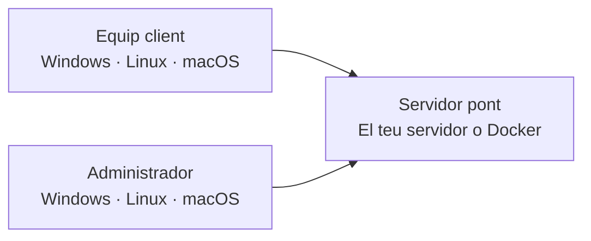

<div align="center">

# 🦎 Gecko

**Suport i control remot lleuger, privat i de codi obert.**

[](https://github.com/jaanque/Gecko/actions/workflows/ci.yml)
[](LICENSE)


*Connecta i assisteix equips Windows, Linux i macOS des de qualsevol xarxa, sense instal·lacions al client, sense serveis de tercers i amb control total sobre la teva infraestructura.*

[Per què Gecko?](#-per-què-gecko) · [Com funciona](#-com-funciona) · [Inici ràpid](#-inici-ràpid) · [Documentació](docs/PRODUCCIO.md) · [Contribuir](CONTRIBUTING.md)

</div>

---

## ✨ Per què Gecko?

- **Sense instal·lació per a l'usuari**: un únic executable portable personalitzable amb el teu logotip i idioma (**Català**, **Español**, **English**). L'usuari només l'obre i tria **Permetre** o **Denegar**.
- **Privacitat i seguretat reals**: connexions xifrades extrem a extrem amb certificats mutus, credencials revocables per client i consentiment explícit obligatori abans de prendre el control.
- **Ràpid i lleuger**: escrit íntegrament en Go pur, amb captura acelerada per GPU (**DXGI Desktop Duplication**) a Windows, imatge nítida per a text i suport multimonitor.
- **Multiplataforma de veritat**: administra des de Windows, Linux o macOS i dóna suport a equips Windows, Linux (X11 / Wayland) i macOS.
- **Fet per al suport del dia a dia**: portapapers bidireccional, enviament segur de fitxers, cerca d'equips i accions ràpides de sistema integrades.
- **100% autoallotjat i Open Source**: desplega el teu propi servidor pont en segons i no depenguis de cap plataforma externa ni subscripció.

---

## 🔗 Com funciona

Ni els clients ni l'administrador han d'obrir ports al router ni al tallafocs: tothom es connecta de manera sortint al teu servidor pont.



---

## 🚀 Inici ràpid

1. **Compila els binaris** (requereix Go 1.22+):
   ```sh
   go run ./cmd/build
   ```
2. **Arrenca el servidor pont** al teu servidor o amb Docker (`RelayServidor`).
3. **Obre `AdminRemoto`** (natiu a Windows o via consola web local a Linux/macOS), connecta-hi el servidor, genera el client i ja pots donar suport remot.

📘 Consulta la **[Guia tècnica i de producció](docs/PRODUCCIO.md)** per al desplegament detallat (Docker, `systemd`, Windows Server), gestió de seguretat, dreceres i resolució de problemes.

---

## 🤝 Open Source i comunitat

**Gecko** és un projecte de codi obert:

- **Vols contribuir?** Llegeix la guia a [CONTRIBUTING.md](CONTRIBUTING.md).
- **Has trobat un problema de seguretat?** Revisa [SECURITY.md](SECURITY.md) per informar-ne de manera privada.
- **Novetats per versió**: consulta [CHANGELOG.md](CHANGELOG.md).

---

## 📄 Llicència

Publicat sota la llicència **[MIT](LICENSE)**. Ets lliure d'utilitzar-lo, modificar-lo i distribuir-lo tant en projectes personals com comercials.
