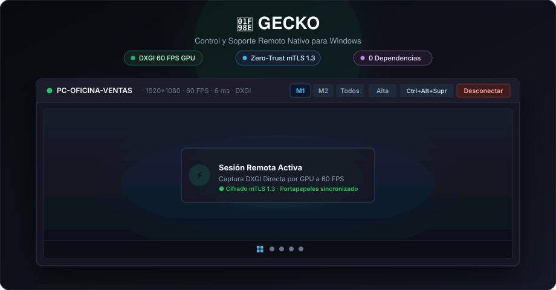
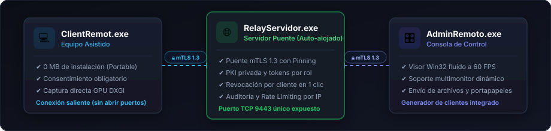

<div align="center">



[](https://github.com/jaanque/Gecko/actions/workflows/ci.yml)
[](LICENSE)
-0078D4.svg?logo=windows&logoColor=white)


*Control y asistencia remota para Windows: nativo, ultraligero, privado y de código abierto.*

</div>

---

### ⚡ Características

| ⚡ Rendimiento | 🛡️ Privacidad | 🪟 Windows Nativo |
| :--- | :--- | :--- |
| **DirectX 11 DXGI 60 FPS**<br/>Captura por hardware directa en VRAM | **Zero-Trust mTLS 1.3**<br/>Cifrado mutuo extremo a extremo con Pinning | **Win32 Nativo Puro**<br/>Sin runtimes, frameworks ni dependencias |
| **Teselas híbridas adaptativas**<br/>Texto 100% nítido sin pérdida y vídeo fluido | **Consentimiento activo**<br/>El usuario final autoriza cada sesión | **Per-Monitor DPI v2**<br/>Escalado nítido en pantallas 4K y multi-monitor |
| **Multimonitor instantáneo**<br/>Selección de monitor (`M1`, `M2`...) o escritorio | **Revocación en caliente**<br/>Invalidación inmediata de acceso en un clic | **Portapapeles & Archivos**<br/>Sincronización en tiempo real y envío con SHA-256 |

---

### 🔗 Arquitectura

<div align="center">



<sub>Sin abrir puertos en el router ni en el firewall: clientes y administradores se conectan de forma saliente hacia el Relay.</sub>

</div>

---

### 📊 Comparativa

| Capacidad | 🦎 Gecko | TeamViewer / AnyDesk | Herramientas Tradicionales |
| :--- | :---: | :---: | :---: |
| **Instalación en cliente** | ❌ **0 MB** (Portable) | ⚠️ 50–150 MB (Instalador + drivers) | ⚠️ Instalación requerida |
| **Dependencias externas** | ✅ **0** (Go puro + Win32) | ❌ Decenas de librerías y runtimes | ❌ Runtimes pesados |
| **Captura de pantalla** | ✅ **DXGI Hardware 60 FPS** | ⚠️ Hooking / Polling GDI | ⚠️ Polling lento |
| **Infraestructura** | ✅ **100% Auto-alojada** | ❌ Nube de terceros obligatoria | ❌ Servidores centralizados |
| **Cifrado de red** | ✅ **mTLS 1.3 + Pinning** | ⚠️ Propietario / Cerrado | ⚠️ Sin validación mutua |
| **Revocación por equipo** | ✅ **Instantánea en 1 clic** | ⚠️ Panel web externo | ⚠️ Manual o inexistente |

---

### 🚀 Inicio Rápido

```sh
# 1. Compilar ejecutables nativos (Go 1.22+)
go run ./cmd/build

# 2. Iniciar el servidor puente (alojado en tu servidor o VPS)
dist\RelayServidor.exe

# 3. Abrir la consola de control y conectarse
dist\AdminRemoto.exe
```

---

<div align="center">

[](docs/PRODUCCIO.md)
[](CONTRIBUTING.md)
[](SECURITY.md)
[](LICENSE)

</div>
