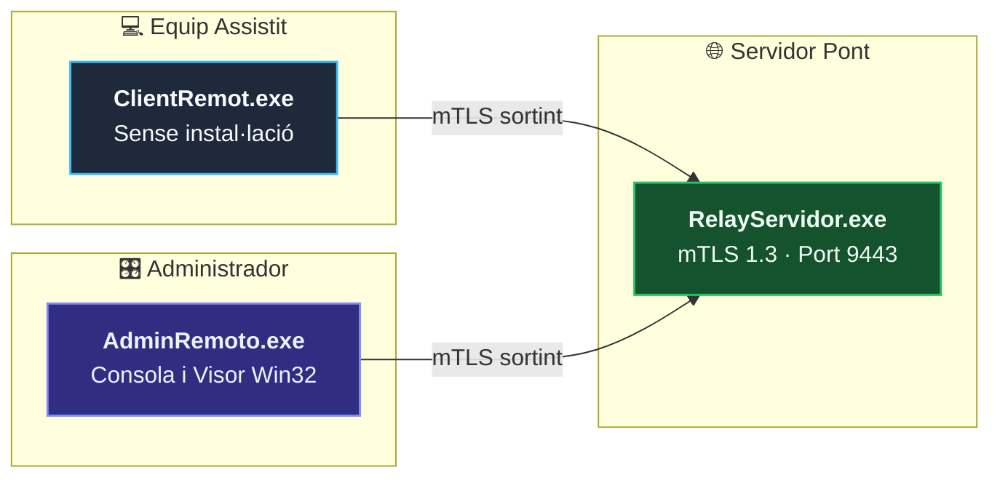

<div align="center">

# 🦎 Gecko

**Control i suport remot per a Windows.**  
*Natiu · Lleuger · Segur · Codi Obert*

[](https://github.com/jaanque/Gecko/actions/workflows/ci.yml)
[](LICENSE)
-0078D4.svg?logo=windows&logoColor=white)


</div>

---

### ✨ Característiques

| ⚡ Rendiment | 🛡️ Seguretat | 🪟 Windows Natiu |
| :--- | :--- | :--- |
| **GPU DXGI 60 FPS**<br/>Captura directa per maquinari | **Zero-Trust mTLS 1.3**<br/>Xifratge extrem a extrem | **Win32 Natiu Pur**<br/>Sense runtimes ni dependències |
| **Tessel·les híbrides**<br/>Text nítid i moviment fluid | **Consentiment actiu**<br/>L'usuari autoritza el control | **DPI Awareness v2**<br/>Escalat nítid en qualsevol monitor |
| **Multimonitor**<br/>Pantalla individual o combinada | **Revocació en un clic**<br/>Tall d'accés instantani | **Portapapers i fitxers**<br/>Eines essencials integrades |

---

### 🔗 Com funciona

Sense obrir ports al router ni configurar tallafocs: tothom es connecta de manera sortint al servidor pont.



---

### 🧩 Components

| Binari | Rol | Descripció |
| :--- | :--- | :--- |
| 🎛️ **`AdminRemoto.exe`** | Administrador | Consola de control, visor fluid a 60 FPS i generador de clients. |
| 🌐 **`RelayServidor.exe`** | Servidor | Servidor pont mTLS, gestor de credencials i auditoria de sessions. |
| 💻 **`ClientRemot.exe`** | Client | Executable portable sense instal·lació. Doble clic i llest. |

---

### 🚀 Inici ràpid

```sh
# 1. Compilar executables (Go 1.22+)
go run ./cmd/build

# 2. Iniciar el servidor pont (al servidor)
dist\RelayServidor.exe

# 3. Obrir la consola de control (a l'equip d'administració)
dist\AdminRemoto.exe
```

---

### 📚 Documentació

| Recurs | Contingut |
| :--- | :--- |
| 📘 **[Guia de producció](docs/PRODUCCIO.md)** | Configuració de xarxa, desplegament, seguretat i dreceres. |
| 🤝 **[Contribuir](CONTRIBUTING.md)** | Directrius de desenvolupament i estil de codi. |
| 🛡️ **[Seguretat](SECURITY.md)** | Política de reporte responsable de vulnerabilitats. |
| 📜 **[Llicència MIT](LICENSE)** | Codi obert per a ús personal i comercial. |
