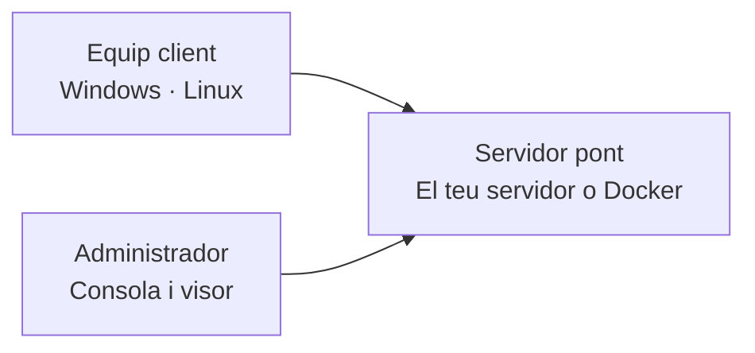

<div align="center">

# 🦎 Gecko

**Suport i control remot lleuger, privat i de codi obert.**

[](https://github.com/jaanque/Gecko/actions/workflows/ci.yml)
[](LICENSE)


*Connecta i assisteix equips Windows i Linux des de qualsevol xarxa, sense instal·lacions al client, sense serveis de tercers i amb control total sobre la teva infraestructura.*

[Per què Gecko?](#-per-què-gecko) · [Com funciona](#-com-funciona) · [Inici ràpid](#-inici-ràpid) · [Documentació](docs/PRODUCCIO.md) · [Contribuir](#-open-source-i-contribucions)

</div>

---

## ✨ Per què Gecko?

- **Sense instal·lació per a l'usuari**: un únic executable portable personalitzable amb el teu logotip. L'usuari només l'obre i tria **Permetre** o **Denegar**.
- **Privacitat i seguretat reals**: totes les connexions són xifrades extrem a extrem amb certificats mutus, cada client es pot revocar individualment i ningú no entra sense el consentiment explícit de l'usuari.
- **Ràpid i lleuger**: escrit íntegrament en Go pur. Imatge nítida per a text, fluida per a moviment i amb suport multimonitor.
- **Fet per al suport del dia a dia**: sincronització de portapapers, enviament segur de fitxers, cerca d'equips i accions ràpides de sistema integrades.
- **100% autoallotjat i Open Source**: desplega el teu propi servidor pont en segons i no depenguis de cap plataforma externa ni subscripció.

---

## 🔗 Com funciona

Ni els clients ni l'administrador han d'obrir ports al router ni al tallafocs: tothom es connecta de manera sortint al teu servidor pont.



---

## 🚀 Inici ràpid

1. **Compila els binaris** (requereix Go 1.22+):
   ```sh
   go run ./cmd/build
   ```
2. **Arrenca el servidor pont** al teu servidor o amb Docker (`RelayServidor`).
3. **Obre `AdminRemoto.exe`**, connecta-hi el servidor, genera el client (`ClientRemot`) i ja pots donar suport remot.

📘 Per a la guia completa de desplegament (Docker, `systemd`, Windows Server), gestió de seguretat, dreceres i resolució de problemes, consulta la **[Guia tècnica i de producció](docs/PRODUCCIO.md)**.

---

## 🤝 Open Source i contribucions

**Gecko** és un projecte de codi obert i qualsevol ajuda és benvinguda:

- Tens una idea o has trobat un error? Obre una **Issue**.
- Vols millorar codi, traduccions o documentació? Envia una **Pull Request**.
- Et resulta útil? Deixa una ⭐ al repositori per ajudar a fer-lo créixer.

---

## 📄 Llicència

Publicat sota la llicència **[MIT](LICENSE)**. Ets lliure d'utilitzar-lo, modificar-lo i distribuir-lo tant en projectes personals com comercials.
