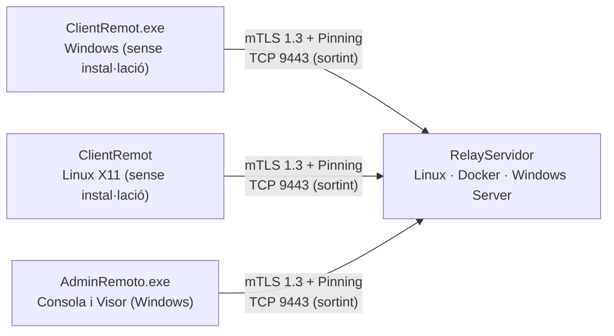
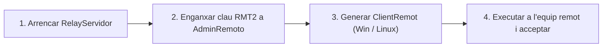

<div align="center">

# Gecko

**Plataforma de control i suport remot en Go pur, segura per defecte i sense dependències externes.**

[](https://github.com/jaanque/Gecko/actions/workflows/ci.yml)


*Connecta equips Windows i Linux (X11) entre xarxes diferents sense obrir ports ni als clients ni a l'administrador.*

[Arquitectura](#arquitectura) · [Característiques](#característiques-principals) · [Desplegament en producció](#desplegament-en-producció) · [Ús diari](#posada-en-marxa-i-ús-diari) · [Seguretat](#seguretat-i-administració-en-producció) · [Resolució de problemes](#resolució-de-problemes)

</div>

---

## Arquitectura

Totes les connexions són **sortints** cap al servidor pont (`RelayServidor`) xifrades amb **TLS 1.3 mutu (mTLS)** i verificació estricta de la petjada **SHA-256** del certificat del servidor (*certificate pinning*). Cap equip client ni cap consola d'administració no necessita exposar ports a Internet.



---

## Característiques principals

### Seguretat pensada per a producció
- **mTLS 1.3 obligatori**: cada connexió exigeix certificat X.509 signat per la CA privada del Relay, a més de *pinning* SHA-256 en temps constant i tokens de 256 bits separats per rol (`admin` vs `client`).
- **Credencials individuals revocables**: cada client generat des de l'Admin (estant connectat al Relay) rep un certificat mTLS i un token propis. Si un executable es filtra o deixa de fer-se servir, es pot **revocar individualment** amb desconnexió immediata.
- **Consentiment explícit de l'usuari**: la injecció de ratolí i teclat resta bloquejada a nivell de sistema operatiu fins que l'usuari final prem **Permetre** (amb temps límit automàtic i botó **Desconnectar** sempre visible).
- **Protecció del Relay**: *rate limiting* per IP (connexions concurrents i finestra lliscant), límits estrictes de mida per tipus de missatge abans d'assignar memòria, registre d'auditoria de sessions amb durada i ocultació de la clau mestra als logs després de la primera arrencada.

### Rendiment i experiència d'ús
- **Codificació híbrida per tessel·les (64×64)** en paral·lel: tessel·les de text/interfície sense pèrdua (*Zlib-BGR*) per mantenir la nitidesa absoluta i *JPEG* ràpid per a vídeo o fotografia.
- **Control de flux per ACK** (*sliding window* de 2 fotogrames) per mantenir una latència mínima fins i tot en connexions lentes, amb indicador en temps real de resolució, FPS i latència (ms).
- **Multimonitor natiu**: selecció de monitor individual (`M1`, `M2`, ...) o escriptori complet (`Todos`).

### Eines de suport integrades
- **Portapapers bidireccional**: sincronització automàtica de text UTF-8 entre administrador i client durant la sessió activa.
- **Transferència de fitxers**: enviament segur de fitxers fins a **50 MB** amb verificació d'integritat **SHA-256**, sanejament de nom i desat a `Downloads` sense sobreescriure fitxers existents.
- **Acció de sistema (`CAD`)**: enviament de `Ctrl+Alt+Supr` (`SendSAS` en Windows, `XTEST` en Linux).
- **Panell de gestió complet**: cerca en temps real per nom d'equip, usuari, sistema operatiu o IP; personalització del client amb logotip propi (PNG/JPG).

---

## Components

| Binari | Plataforma | Funció |
| :--- | :--- | :--- |
| `RelayServidor` / `RelayServidor.exe` | Linux (amd64/arm64), Docker (`scratch`), Windows Server | Servidor pont mTLS 1.3, gestió de PKI/revocació, auditoria i enrutament de sessions. |
| `AdminRemoto.exe` | Windows (amd64/arm64) | Consola d'administració, visor remot natiu Win32 i generador de clients amb logotip. |
| `ClientRemot.exe` | Windows (amd64/arm64) | Agent portable sense instal·lació (interfície en català). |
| `ClientRemot` | Linux X11 (amd64/arm64) | Agent portable en Go pur sobre protocol X11 natiu (interfície en català). |

---

## Compilació i verificació

Requereix **Go 1.22 o superior** (sense `cgo` ni dependències externes; funciona des de Windows, Linux o macOS):

```sh
# Compilar tots els binaris (amd64 per defecte) a dist/
go run ./cmd/build

# Compilar per a arquitectura ARM64
go run ./cmd/build -arch arm64

# Executar tota la bateria de tests amb detector de condicions de cursa
go test -race -count=1 ./...
```

---

## Desplegament en producció

> [!IMPORTANT]
> **Requisits de xarxa**: només cal obrir el port **TCP 9443** (o el configurat a `-listen`) d'entrada al servidor on s'executa `RelayServidor`. Els equips clients i l'administrador només fan connexions TCP sortints.

### Opció 1 · Docker / Docker Compose (Recomanat)

La imatge final es construeix sobre `scratch` (~5,5 MB), no inclou cap shell ni eines innecessàries i incorpora **`HEALTHCHECK` natiu**.

```sh
docker build -t gecko-relay .

docker run -d \
  --name gecko-relay \
  --restart unless-stopped \
  -e RELAY_PUBLIC_ADDR=suport.el-teu-domini.cat:9443 \
  -p 9443:9443 \
  -v gecko_relay_data:/data \
  gecko-relay
```

Exemple de `docker-compose.yml`:

```yaml
services:
  gecko-relay:
    build: .
    container_name: gecko-relay
    restart: unless-stopped
    ports:
      - "9443:9443"
    environment:
      RELAY_LISTEN: ":9443"
      RELAY_DATA_DIR: "/data"
      RELAY_PUBLIC_ADDR: "suport.el-teu-domini.cat:9443"
    volumes:
      - gecko_relay_data:/data

volumes:
  gecko_relay_data:
```

Per obtenir la clau inicial (o consultar-la més endavant sense deixar-la als logs d'arrencada):

```sh
# Primera inicialització (es mostra un sol cop)
docker logs gecko-relay

# Consultar la clau mestra puntualment en qualsevol moment
docker exec gecko-relay /RelayServidor -show-key
```

### Opció 2 · Linux natiu amb `systemd`

1. Copia el binari i crea un usuari dedicat sense privilegis:
   ```sh
   sudo useradd --system --home /var/lib/gecko-relay --shell /usr/sbin/nologin gecko
   sudo install -m 0755 dist/RelayServidor /usr/local/bin/gecko-relay
   sudo install -d -o gecko -g gecko -m 0700 /var/lib/gecko-relay
   ```

2. Crea la unitat `/etc/systemd/system/gecko-relay.service`:
   ```ini
   [Unit]
   Description=Gecko RelayServidor (mTLS 1.3)
   After=network-online.target
   Wants=network-online.target

   [Service]
   Type=simple
   User=gecko
   Group=gecko
   ExecStart=/usr/local/bin/gecko-relay -listen :9443 -data-dir /var/lib/gecko-relay -public-addr suport.el-teu-domini.cat:9443
   Restart=always
   RestartSec=3
   NoNewPrivileges=true
   PrivateTmp=true
   ProtectSystem=strict
   ReadWritePaths=/var/lib/gecko-relay

   [Install]
   WantedBy=multi-user.target
   ```

3. Activa el servei i obtén la clau mestra:
   ```sh
   sudo systemctl daemon-reload
   sudo systemctl enable --now gecko-relay
   sudo -u gecko /usr/local/bin/gecko-relay -data-dir /var/lib/gecko-relay -public-addr suport.el-teu-domini.cat:9443 -show-key
   ```

### Opció 3 · Windows Server

```cmd
RelayServidor.exe -listen :9443 -data-dir C:\GeckoRelay\data -public-addr suport.el-teu-domini.cat:9443
```

---

## Posada en marxa i ús diari



1. **Configurar la consola d'administració**
   - Obre `dist\AdminRemoto.exe` i ves a la pestanya **Servidor**.
   - Enganxa la clau `RMT2:...` (el botó **Pegar** omple automàticament la direcció del servidor) i prem **Guardar y conectar**.
2. **Generar executables de client**
   - Ves a **Crear cliente**, selecciona opcionalment un **logo** (PNG o JPG; s'ajusta automàticament fins a 128×128 amb transparència) i prem **Guardar .exe** (Windows) o **Guardar Linux**.
   - Si l'Admin està connectat al Relay, cada fitxer generat incorpora automàticament una **credencial mTLS única i revocable**.
3. **Executar el client als equips finals**
   - **Windows**: doble clic sobre `ClientRemot.exe`.
   - **Linux (X11)**:
     ```sh
     chmod +x ClientRemot
     ./ClientRemot
     ```
4. **Connectar i donar suport**
   - Els equips apareixen en temps real a la pestanya **Equipos** amb nom d'equip, sistema operatiu, usuari, IP, resolució i nombre de monitors.
   - Usa la barra de cerca per filtrar ràpidament, prem **Conectar** i espera que l'usuari confirmi prement **Permetre**.

---

## Dreceres i controls del visor remot

| Control / Drecera | Acció |
| :--- | :--- |
| **`F11`** | Activar o sortir de pantalla completa. |
| **`Ctrl+Alt+M`** | Amagar o mostrar la barra superior del visor. |
| **`Ctrl+Alt+Q`** | Tancar la sessió remota immediatament. |
| **`M1` `M2` ... `Todos`** | Canviar entre monitors individuals o veure tot l'escriptori virtual. |
| **`Baja` / `Estándar` / `Alta`** | Ajustar la qualitat de compressió en directe (`55` / `78` / `92`). |
| **`Archivo`** | Enviar un fitxer (fins a 50 MB, verificat amb SHA-256) a `Downloads` de l'equip remot. |
| **`CAD`** | Enviar la seqüència `Ctrl+Alt+Supr` a l'equip remot. |
| **Portapapers** | Automàtic en tots dos sentits en copiar text durant una sessió activa. |

---

## Seguretat i administració en producció

### Referència de paràmetres i variables d'entorn (`RelayServidor`)

| Flag CLI | Variable d'entorn | Valor per defecte | Descripció |
| :--- | :--- | :--- | :--- |
| `-listen` | `RELAY_LISTEN` | `:9443` | Adreça i port TCP TLS 1.3 d'escolta. |
| `-data-dir` | `RELAY_DATA_DIR` | `./data` | Directori on es guarden la CA, certificats, tokens i registre de revocació. |
| `-public-addr` | `RELAY_PUBLIC_ADDR` | IP LAN detectada | Domini o IP pública que s'incorpora a la clau `RMT2:...` (recomanat en producció). |
| `-show-key` | `RELAY_SHOW_KEY` | `false` | Mostra la direcció i la clau mestra `RMT2:...` (en CLI imprimeix i surt). |
| `-list-clients` | — | `false` | Llista totes les credencials individuals emeses i el seu estat (`ACTIVA`/`REVOCADA`). |
| `-revoke <id>` | — | — | Revoca una credencial concreta per ID (o `default` per invalidar la compartida). |
| `-healthcheck` | — | `false` | Comprova localment si el port TCP del Relay respon (codi de sortida `0` o `1`). |

### Gestió de credencials i revocació

- **Des de l'Admin**: a la pestanya **Equipos**, el botó **Revocar** invalida la credencial del client seleccionat, talla la connexió a l'instant i bloqueja qualsevol intent de reconnexió futur.
- **Des de la línia d'ordres del servidor**:
  ```sh
  ./RelayServidor -data-dir /var/lib/gecko-relay -list-clients
  ./RelayServidor -data-dir /var/lib/gecko-relay -revoke <credential_id>
  ```

### Còpia de seguretat i protecció de `data/`

> [!CAUTION]
> El directori `data/` del servidor conté les claus privades de la CA (`ca.key`), el servidor (`server.key`), els certificats mTLS, els tokens (`relay_secret.json`) i l'estat de revocació (`issued_clients.json`).
> - Mantén permisos estrictes (`0700` al directori, `0600` a les claus).
> - Fes còpies de seguretat xifrades de `data/`: si es perd, caldrà reconfigurar l'Admin i regenerar els clients.
> - No publiquis mai la clau `RMT2:...` ni la desis en repositoris ni xats no segurs.

---

## Estructura del projecte

```text
.
├── cmd/
│   ├── admin/          # Consola i visor natiu de Windows (AdminRemoto.exe)
│   ├── build/          # Compilador multiplataforma en Go pur (go run ./cmd/build)
│   ├── client/         # Agent client Windows i Linux X11 (ClientRemot)
│   └── relay/          # Servidor pont mTLS 1.3 i CLI d'administració (RelayServidor)
├── internal/
│   ├── admin/          # Client de connexió de l'Admin cap al Relay i enviament de fitxers
│   ├── clientui/       # Estats, callbacks i tipus de monitor compartits
│   ├── config/         # Incrustació/lectura de configuració al binari i normalització de logos
│   ├── linux/          # Client X11 en Go pur (RANDR, XTEST, XFIXES, UI, Wayland, portapapers)
│   ├── protocol/       # Protocol binari/JSON amb validació estricta de tipus i mides
│   ├── relay/          # Nucli del servidor pont, rate limiting per IP i auditoria
│   ├── security/       # PKI mTLS 1.3, pinning SHA-256, claus RMT2 i revocació per client
│   ├── transfer/       # Receptor segur de fitxers amb SHA-256 i prevenció de path traversal
│   ├── video/          # Codificador i descodificador híbrid de tessel·les 64×64 (Zlib-BGR + JPEG)
│   └── win/            # Interfície Win32, captura GDI, injecció SendInput/SendSAS i portapapers
├── Dockerfile          # Imatge de producció mínima sobre scratch amb HEALTHCHECK
└── .github/workflows/  # Integració contínua (gofmt, go vet multi-SO, tests i cross-build)
```

---

## Resolució de problemes

- **Pantalla negra o error en Linux (Wayland)**: el client Linux utilitza el protocol X11 natiu (`GetImage` + `XTEST`). Si la sessió gràfica corre sobre Wayland, la finestra del client mostrarà un avís automàtic; tanca la sessió d'escriptori i selecciona **Xorg / X11** a la pantalla d'inici de sessió.
- **El portapapers no se sincronitza en Linux**: comprova que l'equip remot té instal·lat `xclip` o `xsel` (p. ex. `sudo apt install xclip`).
- **Pantalla pausada en aparèixer UAC o pantalla bloquejada en Windows**: per disseny de seguretat de Windows, la captura GDI (`BitBlt`) i `SendSAS` (`Ctrl+Alt+Supr`) des d'un procés d'usuari estàndard no poden interactuar amb l'escriptori segur (*Secure Desktop*). Per donar suport sobre UAC cal executar el client amb privilegis elevats/servei `SYSTEM` i la política *SoftwareSASGeneration* habilitada.
- **El Relay no mostra la clau en reiniciar**: és intencionat per evitar exposar la clau mestra als logs del sistema o de Docker. Executa `RelayServidor -show-key` per visualitzar-la de manera controlada.
