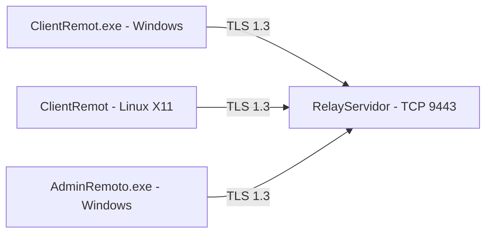
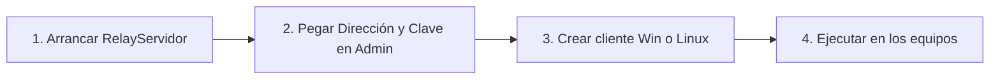

# Control Remoto

Control remoto en **Go puro** con servidor puente **TLS 1.3** para conectar equipos **Windows y Linux (X11)** desde cualquier red sin abrir puertos en el administrador ni en los clientes.



## Componentes

| Archivo | Función |
| :--- | :--- |
| `RelayServidor` / `RelayServidor.exe` | Servidor puente (Linux, Docker o Windows Server). |
| `AdminRemoto.exe` | Panel de administración, visor remoto y generador de clientes. |
| `ClientRemot.exe` / `ClientRemot` | Cliente sin instalación (Windows / Linux X11, en catalán). Solo pide **Permetre** o **Denegar**. |

## Compilar

Requiere Go 1.22+:

```cmd
build.bat
```

Genera los ejecutables en `dist\`.

## Puesta en marcha



### 1. Arrancar el servidor puente

Abre el puerto **TCP 9443** en el firewall del servidor y ejecútalo:

- **Windows Server**
  ```cmd
  RelayServidor.exe
  ```
- **Linux**
  ```bash
  chmod +x RelayServidor
  ./RelayServidor
  ```
- **Docker**
  ```bash
  docker build -t remote-relay .
  docker run -d --name remote-relay --restart unless-stopped -p 9443:9443 -v relay_data:/data remote-relay
  docker logs remote-relay
  ```

*(Opcional: usa `-public-addr tu.dominio.com:9443` si prefieres mostrar un dominio en lugar de la IP detectada).*

Al iniciar imprimirá:
- **`Direccion:`** `host:9443`
- **`Clave:`** `RMT1:...`

### 2. Conectar y generar el cliente

1. Abre `dist\AdminRemoto.exe`, ve a **Servidor**, pega la dirección y la clave y pulsa **Guardar y conectar**.
2. Ve a **Crear cliente**, elige opcionalmente un logo y guarda **`ClientRemot.exe`** (Windows) o **`ClientRemot`** (Linux).
3. Ejecuta el cliente en los equipos y aparecerán automáticamente en **Equipos**:
   - **Windows**: doble clic en `ClientRemot.exe`
   - **Linux (X11)**:
     ```bash
     chmod +x ClientRemot
     ./ClientRemot
     ```

## Atajos en el visor

- **`F11`** — Pantalla completa
- **`Ctrl+Alt+M`** — Mostrar u ocultar barra superior
- **`Ctrl+Alt+Q`** — Cerrar sesión remota
