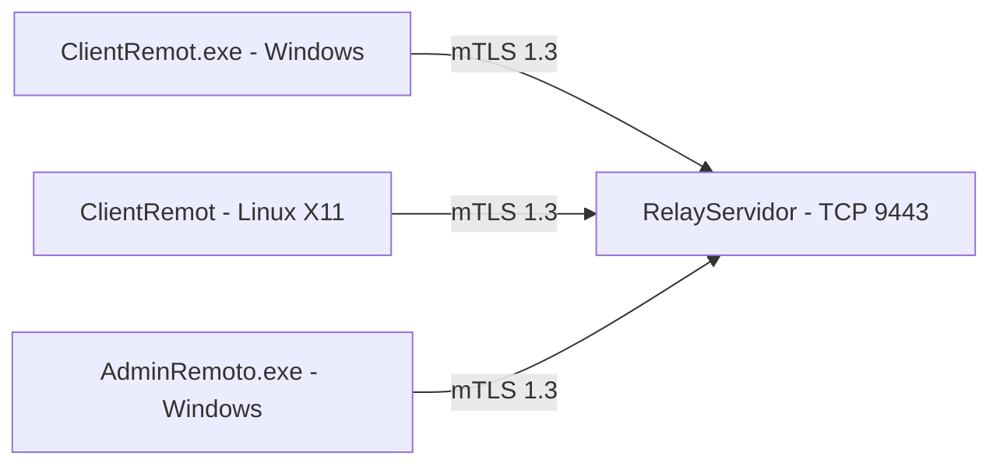
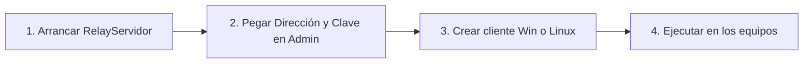

# Control Remoto

Control remoto en **Go puro** (cero dependencias externas) con servidor puente **mTLS 1.3** para conectar equipos **Windows y Linux (X11)** desde cualquier red sin abrir puertos en el administrador ni en los clientes.



## Componentes

| Archivo | Función |
| :--- | :--- |
| `RelayServidor` / `RelayServidor.exe` | Servidor puente (Linux, Docker o Windows Server) con emisión/revocación de credenciales por cliente y rate limiting por IP. |
| `AdminRemoto.exe` | Panel de administración (búsqueda, SO/usuario, revocación), visor remoto (portapapeles bidireccional, envío de archivos, `Ctrl+Alt+Supr`) y generador de clientes. |
| `ClientRemot.exe` / `ClientRemot` | Cliente sin instalación (Windows / Linux X11, en catalán). Solo pide **Permetre** o **Denegar**. |

## Compilar

Requiere Go 1.22+ (funciona en Windows, Linux y macOS):

```sh
go run ./cmd/build
```

*(Opcional: `go run ./cmd/build -arch arm64` para compilar binarios ARM64).*

Genera los ejecutables en `dist/`.

## Puesta en marcha



### 1. Arrancar el servidor puente

Abre el puerto **TCP 9443** en el firewall del servidor y ejecútalo:

- **Windows Server**
  ```cmd
  RelayServidor.exe -public-addr remoto.tudominio.com:9443
  ```
- **Linux**
  ```sh
  chmod +x RelayServidor
  ./RelayServidor -public-addr remoto.tudominio.com:9443
  ```
- **Docker**
  ```sh
  docker build -t remote-relay .
  docker run -d --name remote-relay --restart unless-stopped \
    -e RELAY_PUBLIC_ADDR=remoto.tudominio.com:9443 \
    -p 9443:9443 -v relay_data:/data remote-relay
  docker logs remote-relay
  ```

Por seguridad, la clave maestra `RMT2:...` **solo se imprime la primera vez** que se genera la identidad en `data/`. Para volver a mostrarla o gestionar clientes emitidos:

```sh
./RelayServidor -show-key             # Mostrar Dirección y Clave RMT2:...
./RelayServidor -list-clients         # Listar credenciales emitidas por cliente
./RelayServidor -revoke <id>          # Revocar una credencial concreta (o 'default')
./RelayServidor -healthcheck          # Comprobar estado local (usado por Docker HEALTHCHECK)
```

### 2. Conectar y generar el cliente

1. Abre `dist\AdminRemoto.exe`, ve a **Servidor**, pega la clave `RMT2:...` (rellena la dirección automáticamente) y pulsa **Guardar y conectar**.
2. Ve a **Crear cliente**, elige opcionalmente un logo y guarda **`ClientRemot.exe`** (Windows) o **`ClientRemot`** (Linux).
   - Al generar clientes estando conectado al Relay, cada binario recibe un **certificado mTLS y token propios** que puedes revocar individualmente desde el botón **Revocar** en **Equipos** o con `-revoke <id>`.
3. Ejecuta el cliente en los equipos y aparecerán automáticamente en **Equipos** con su nombre, SO, usuario, IP y monitores:
   - **Windows**: doble clic en `ClientRemot.exe`
   - **Linux (X11)**:
     ```sh
     chmod +x ClientRemot
     ./ClientRemot
     ```
     *(Nota: si el escritorio Linux corre bajo Wayland, el cliente avisará en pantalla; cambia a sesión Xorg/X11 para captura y control completos. Para sincronización de portapapeles en Linux se usa `xclip` o `xsel` si está instalado).*

## Funciones y atajos en el visor

- **Portapapeles bidireccional**: el texto copiado se sincroniza automáticamente entre Admin y Cliente durante la sesión activa.
- **Envío de archivos (`Archivo`)**: transfiere archivos de hasta 50 MB con verificación SHA-256 a la carpeta `Downloads` del equipo remoto sin sobrescribir archivos existentes.
- **Acción de sistema (`CAD`)**: envía `Ctrl+Alt+Supr` (en Windows usa `SendSAS`; efectivo con servicio SYSTEM / política SAS habilitada).
- **`F11`** — Pantalla completa
- **`Ctrl+Alt+M`** — Mostrar u ocultar barra superior
- **`Ctrl+Alt+Q`** — Cerrar sesión remota
