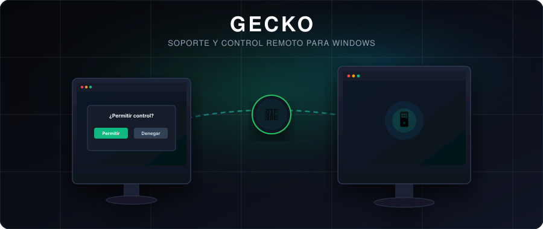

<div align="center">



# 🦎 Gecko

**Control y asistencia remota para Windows.**  
*Rápido, privado, sin instalación y de código abierto.*

<br/>

[](https://github.com/jaanque/Gecko)
[](https://github.com/jaanque/Gecko)
[](LICENSE)

<br/>

| ⚡ **60 FPS GPU** | 🔒 **mTLS 1.3** | 🪟 **Win32 Nativo** | 📦 **0 Instalación** |
| :---: | :---: | :---: | :---: |
| Captura DirectX 11 DXGI | Cifrado mutuo con Pinning | Cero dependencias externas | Doble clic y listo |

<br/>

</div>

---

### 🚀 Inicio Rápido

```sh
# 1. Compilar todo (Windows amd64 / arm64)
go run ./cmd/build

# 2. Iniciar el servidor puente
dist\RelayServidor.exe

# 3. Abrir la consola de control
dist\AdminRemoto.exe
```

---

<div align="center">

[📘 **Guía de Producción**](docs/PRODUCCIO.md) &nbsp;•&nbsp; [🤝 **Contribuir**](CONTRIBUTING.md) &nbsp;•&nbsp; [🛡️ **Seguridad**](SECURITY.md) &nbsp;•&nbsp; [⚖️ **Licencia MIT**](LICENSE)

</div>
