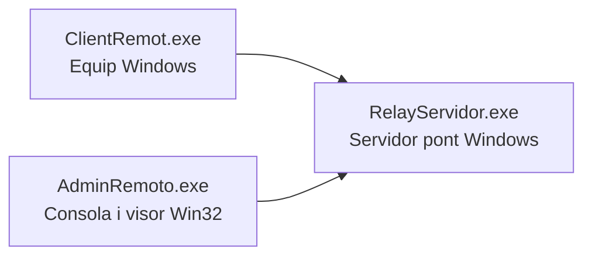

<div align="center">

# 🦎 Gecko

**Suport i control remot per a Windows: natiu, lleuger, privat i de codi obert.**

[](https://github.com/jaanque/Gecko/actions/workflows/ci.yml)
[](LICENSE)

-0078D4?logo=windows&logoColor=white)

*Connecta i assisteix equips Windows des de qualsevol xarxa, sense instal·lacions al client, sense serveis de tercers i amb control total sobre la teva infraestructura.*

[Per què Gecko?](#-per-què-gecko) · [Com funciona](#-com-funciona) · [Inici ràpid](#-inici-ràpid) · [Documentació](docs/PRODUCCIO.md) · [Contribuir](CONTRIBUTING.md)

</div>

---

## ✨ Per què Gecko?

- **Natiu per a Windows**: interfície Win32 pura, suport Per-Monitor DPI v2 (`WM_DPICHANGED`) i captura accelerada per GPU (**DXGI Desktop Duplication**) amb *fallback* transparent a GDI per a monitors HDR, rotats o sessions RDP.
- **Sense instal·lació per a l'usuari**: un únic `ClientRemot.exe` portable personalitzable amb el teu logotip i idioma (**Català**, **Español**, **English**). L'usuari només fa doble clic i tria **Permetre** o **Denegar**.
- **Privacitat i seguretat reals**: connexions xifrades extrem a extrem amb certificats mutus (mTLS 1.3), credencials revocables per equip i consentiment explícit obligatori abans d'activar el control.
- **Ràpid i nítid**: codificació híbrida per tessel·les guiada pels rectangles bruts de la GPU — text nítid sense pèrdua, moviment fluid i suport multimonitor complet.
- **Fet per al suport del dia a dia**: portapapers bidireccional, enviament segur de fitxers amb barra de progrés i SHA-256, cerca d'equips i acció `Ctrl+Alt+Supr` integrats.
- **100% autoallotjat i Open Source**: desplega el teu propi `RelayServidor.exe` i no depenguis de cap plataforma externa ni subscripció.

---

## 🔗 Com funciona

Ni els clients ni l'administrador han d'obrir ports al router ni al tallafocs: tothom es connecta de manera sortint al teu servidor pont.



---

## 🚀 Inici ràpid

1. **Compila els executables** (requereix Go 1.22+):
   ```sh
   go run ./cmd/build
   ```
2. **Arrenca `dist\RelayServidor.exe`** al teu servidor Windows (port TCP 9443).
3. **Obre `dist\AdminRemoto.exe`**, enganxa la clau del servidor, genera `ClientRemot.exe` i ja pots donar suport remot.

📘 Consulta la **[Guia tècnica i de producció](docs/PRODUCCIO.md)** per a la configuració avançada, seguretat, revocació de credencials, dreceres i resolució de problemes.

---

## 🤝 Open Source i comunitat

**Gecko** és un projecte de codi obert:

- **Vols contribuir?** Llegeix la guia a [CONTRIBUTING.md](CONTRIBUTING.md).
- **Has trobat un problema de seguretat?** Revisa [SECURITY.md](SECURITY.md) per informar-ne de manera privada.
- **Novetats per versió**: consulta [CHANGELOG.md](CHANGELOG.md).

---

## 📄 Llicència

Publicat sota la llicència **[MIT](LICENSE)**. Ets lliure d'utilitzar-lo, modificar-lo i distribuir-lo tant en projectes personals com comercials.
