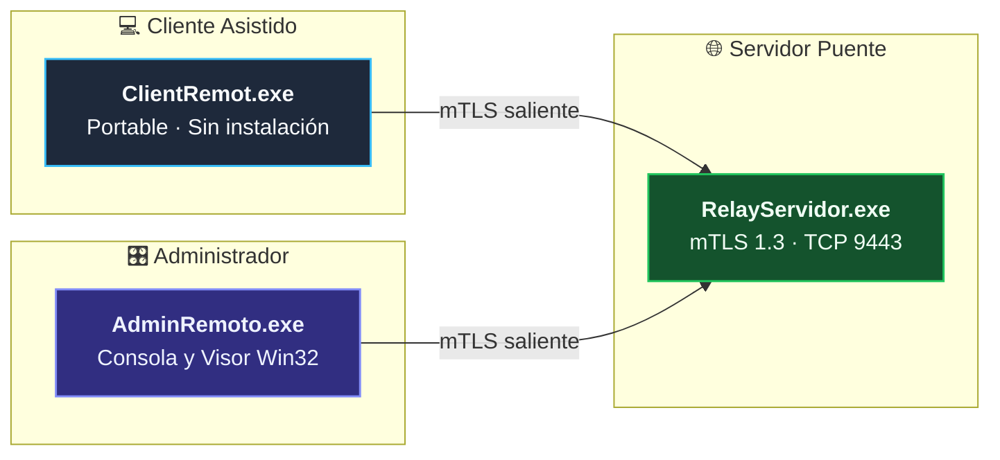

<div align="center">

```
 ██████╗ ███████╗ ██████╗██╗  ██╗ ██████╗ 
██╔════╝ ██╔════╝██╔════╝██║ ██╔╝██╔═══██╗
██║  ███╗█████╗  ██║     █████═╝ ██║   ██║
██║   ██║██╔══╝  ██║     ██╔═██╗ ██║   ██║
╚██████╔╝███████╗╚██████╗██║ ╚██╗╚██████╔╝
 ╚═════╝ ╚══════╝ ╚═════╝╚═╝  ╚═╝ ╚═════╝ 
```

# 🦎 Gecko

**Soporte y control remoto nativo para Windows.**  
*Ultraligero · 60 FPS DXGI GPU · Zero-Trust mTLS 1.3 · Cero dependencias · Código abierto*

[](https://github.com/jaanque/Gecko/actions/workflows/ci.yml)
[](LICENSE)
-0078D4.svg?logo=windows&logoColor=white)


---

</div>

## 🖥️ Visor Remoto

```text
┌────────────────────────────────────────────────────────────────────────┐
│ 🦎 Gecko Viewer ─ PC-OFICINA (1920×1080 · 60 FPS · 8 ms)          [—][□][×]│
├────────────────────────────────────────────────────────────────────────┤
│ [M1] [M2] [Todos] │ Calidad: [Baja] [Estándar] [● Alta] │ [📁 Archivo] │
├────────────────────────────────────────────────────────────────────────┤
│                                                                        │
│          ╔══════════════════════════════════════════════════╗          │
│          ║                                                  ║          │
│          ║        ESCRITORIO REMOTO ACELERADO (DXGI)        ║          │
│          ║                                                  ║          │
│          ╚══════════════════════════════════════════════════╝          │
│                                                                        │
└────────────────────────────────────────────────────────────────────────┘
```
<div align="center">
<sub>Visor nativo Win32: aceleración directa DirectX 11, Per-Monitor DPI v2 y portapapeles sincronizado.</sub>
</div>

---

## 🛡️ Consentimiento Obligatorio

```text
┌────────────────────────────────────────────────────┐
│ 🦎 Asistencia Remota                        [—][×] │
├────────────────────────────────────────────────────┤
│                                                    │
│   Un técnico solicita conectarse a su equipo:      │
│                                                    │
│   Operador: Soporte IT (f9bbdef02173)              │
│   Seguridad: Cifrado mTLS 1.3 extremo a extremo    │
│                                                    │
│          [ ✔ PERMITIR ]      [ ✖ DENEGAR ]         │
│                                                    │
└────────────────────────────────────────────────────┘
```
<div align="center">
<sub>Sin instalación: el usuario asistido solo hace doble clic y decide si autoriza el control.</sub>
</div>

---

## ⚡ Comparativa

| Capacidad | 🦎 Gecko | Herramientas Tradicionales |
| :--- | :---: | :---: |
| **Instalación** | ❌ **0 MB** (Portable) | ⚠️ 50–150 MB (Instalador + drivers) |
| **Dependencias** | ✅ **0** (Go puro + Win32) | ❌ Decenas de librerías y runtimes |
| **Captura GPU** | ✅ **DXGI Direct 60 FPS** | ⚠️ Hooking lento / polling GDI |
| **Privacidad** | ✅ **100% Auto-alojado** | ❌ Nubes de terceros con telemetría |
| **Seguridad de red** | ✅ **mTLS 1.3 + Pinning** | ⚠️ Propietaria / Cerrada |
| **Revocación** | ✅ **Instantánea en 1 clic** | ⚠️ Panel web externo |

---

## 🔗 Arquitectura


<div align="center">
<sub>Sin abrir puertos en clientes ni administradores: todas las conexiones son salientes hacia el Relay.</sub>
</div>

---

## 🚀 Inicio en 3 Pasos

```text
 [1] Compilar       go run ./cmd/build       ──▶   dist/
 [2] Servidor       dist\RelayServidor.exe   ──▶   TCP :9443 (mTLS)
 [3] Conectar       dist\AdminRemoto.exe     ──▶   Soporte instantáneo
```

---

## 📚 Documentación

<div align="center">

[](docs/PRODUCCIO.md)
[](CONTRIBUTING.md)
[](SECURITY.md)
[](LICENSE)

</div>
